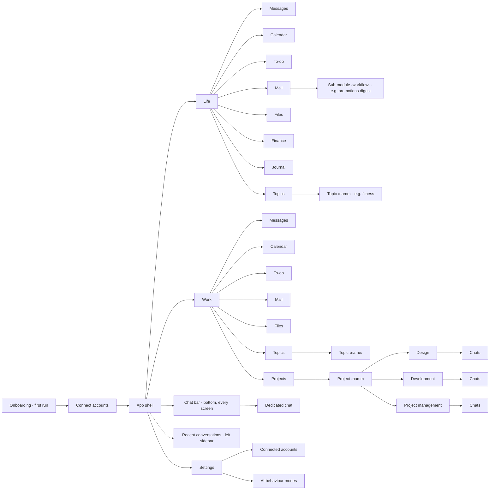

# IA map — screens and modules

> Status: evergreen — the information architecture of Personal Agent: every
> node with a stable id, its parent and its screen type. The source for task 1;
> specs, screens and the component registry refer to nodes by these ids.

<!--
TASK 0 STATE (2026-11-26): drafted from the owner's product brief
(FOUNDATIONS.md § Product brief); confirmed by the owner at G-0. After G-0 a
new node or a moved node is a big task (WORKFLOW.md § Big task or small task).
Conventions: ids are lower-case dotted paths; `<name>` marks a dynamic node
(one instance per topic or project); "global element" nodes are present on
every screen and are not pages.
-->

## Tree

Module-level **workflow** and **memory** settings (`settings.workflow`,
`settings.memory`) are reached from inside each module, not from the tree.

`life.mail.custom` stands for a pattern, not one node: **any base module in
either layer** can grow user-created sub-modules out of conversations the
user marks persistent (or the AI converts). The diagram shows one example.

## Nodes

| IA id | Node | Parent | Screen type | Notes |
| --- | --- | --- | --- | --- |
| `onboarding` | Onboarding | — | first-run flow | Shown once, before the shell; sets the workspace up |
| `onboarding.accounts` | Connect accounts | `onboarding` | wizard step | The user connects the platforms the modules draw on (Google, Slack, Figma, GitHub …); same connectors as `settings.accounts`, which is where they are changed later |
| `root` | App shell | — | shell | Layer switch (Life / Work), chat bar, sidebar toggle; reached after onboarding |
| `life` | Life | `root` | layer home | Overview of the life modules |
| `life.messages` | Messages | `life` | module | Connected messaging accounts |
| `life.calendar` | Calendar | `life` | module | |
| `life.todo` | To-do | `life` | module | |
| `life.mail` | Mail | `life` | module | |
| `life.files` | Files | `life` | module | |
| `life.finance` | Finance records | `life` | module | |
| `life.journal` | Journal | `life` | module | |
| `<module>.<workflow>` | User-created sub-module (e.g. `life.mail.promotions`) | any base module, either layer | sub-module home | Born from a conversation the user switched to *persistent*, or converted by the AI; shows the workflow's standing output (e.g. the mail it pushed and why); its workflow and memory are edited like any module's; dynamic node (D-08) |
| `life.topics` | Topics | `life` | module index | Every conversation with the AI, filed automatically by theme |
| `life.topics.<topic>` | One topic (e.g. fitness) | `life.topics` | topic home | AI-written summary of the important information from the records, then every related conversation; dynamic node |
| `work` | Work | `root` | layer home | Overview of the work modules |
| `work.messages` | Messages | `work` | module | |
| `work.calendar` | Calendar | `work` | module | |
| `work.todo` | To-do | `work` | module | |
| `work.mail` | Mail | `work` | module | |
| `work.files` | Files | `work` | module | |
| `work.projects` | Projects | `work` | module index | |
| `work.projects.<project>` | One project | `work.projects` | project home | Dynamic node; holds the sub-modules below |
| `project.design` | Design | `work.projects.<project>` | sub-module | |
| `project.design.chats` | Chats | `project.design` | conversation list | Every conversation under this sub-module, with a summary |
| `project.dev` | Development | `work.projects.<project>` | sub-module | |
| `project.dev.chats` | Chats | `project.dev` | conversation list | |
| `project.pm` | Project management | `work.projects.<project>` | sub-module | |
| `project.pm.chats` | Chats | `project.pm` | conversation list | |
| `work.topics` | Topics | `work` | module index | Same mechanism as `life.topics`, work-side |
| `work.topics.<topic>` | One topic | `work.topics` | topic home | Dynamic node |
| `chat.bar` | Chat bar | `root` | global element | Fixed to the bottom of every screen; routes each input to the main thread or to a new dedicated chat; carries the **one-off / persistent** switch for the current conversation (D-08) |
| `chat.thread` | Dedicated chat | `chat.bar` | chat window | Opened by the bar for a topic that needs its own thread; filed into Topics afterwards; can be switched to *persistent* at any time, which creates `<module>.<workflow>` under the module it concerns |
| `chat.recent` | Recent conversations | `root` | global element | Left sidebar, collapsed by default, expands to list the user's recent conversations across both layers |
| `settings` | Settings | `root` | settings home | |
| `settings.accounts` | Connected accounts | `settings` | settings page | Google, Slack, Figma, GitHub and other personal or corporate platforms |
| `settings.ai-modes` | AI behaviour modes | `settings` | settings page | Autonomous / assisted / deferred per kind of task |
| `settings.workflow` | Module workflow | any module | panel | Entered from the module; edited by talking to the AI |
| `settings.memory` | Module memory | any module | panel | Entered from the module; what the module remembers and which modules it shares with |

## Decided (D-07, 2026-11-26)

- `life.topics` / `work.topics` are the home of **all** conversations;
  `chat.recent` is a shortcut into them, not a second store.
- The five shared base modules (messages, calendar, to-do, mail, files) are
  **one component family** rendered in both layers; the task-1 spec decides
  the component inventory.
- An **onboarding** flow runs once before the shell; its job is connecting the
  user's platform accounts.

## Decided (D-08, 2026-11-26)

- Every conversation is **one-off by default and switchable to persistent**,
  in the chat bar or the dedicated chat, at any time. Persistent means the AI
  turns it into a sub-module with its own workflow under the module it
  concerns (`<module>.<workflow>`); the AI may also propose the conversion.
