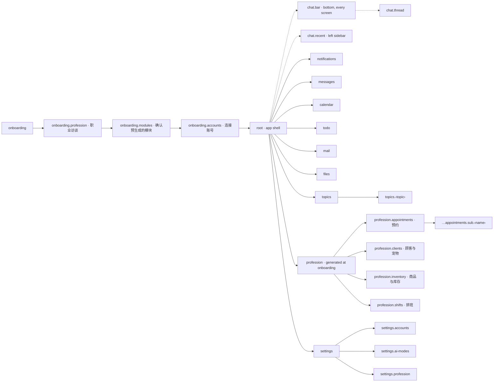

# IA map — screens and modules

> Status: evergreen — the information architecture of Personal Agent: every
> node with a stable id, its parent and its screen type. The source for task 1;
> specs, screens and the component registry refer to nodes by these ids.

<!--
TASK 0 STATE (2026-11-26): rewritten for a single workspace after D-28–D-30
(the Life layer is gone; profession modules replace "projects"; onboarding
starts with a profession interview). To be confirmed by the owner at G-0 —
the gate has not been held yet. After G-0 a
new node or a moved node is a big task (WORKFLOW.md § Big task or small task).
-->

Conventions: ids are lower-case dotted paths; `<name>` marks a dynamic node
(one instance per topic, profession module or user-created sub-module);
"global element" nodes are present on every screen and are not pages. The
node table is the id source; the Mermaid tree shows the same ids (labels
starting with "…" abbreviate the parent path). `workflow`, `memory` and `sub`
are reserved segments: `<module>.workflow` and `<module>.memory` are the
module's editor and memory, `<module>.sub.<name>` a user-created sub-module.
A **module group** node (`profession`) is a navigation heading, not a page: it
has no screen of its own and, like global elements, is exempt from "every
node is reachable". Design detail in the Notes column that goes beyond the
cited decision is the drafting session's proposal; the task-1 spec decides it.

## Tree

Every module is backed by a **workflow** that runs on a schedule and rewrites
the module's screen, and by a **memory**. Both are reached from inside the
module (`<module>.workflow`, `<module>.memory`), not from the tree; the
workflow opens as a node-based editor (D-10). `…appointments.sub.<name>`
stands for a pattern: **any module** can grow user-created sub-modules out of
conversations the user marks persistent, or the AI converts (D-08).

**Every module shares one frame (D-12):** a run-state header (last run and
result, next run, running now, failure, items awaiting approval, history), a
body assembled from registered blocks by the workflow's output, and the
entries to workflow and memory. Layout changes only when the workflow is
edited; content changes per run, with what-changed markers.

## Nodes

| IA id | Node | Parent | Screen type | Notes |
| --- | --- | --- | --- | --- |
| `onboarding` | Onboarding | — | first-run flow | Before the shell; three steps below (D-30). "Shown once" is proposed, `G-0` |
| `onboarding.profession` | Profession interview | `onboarding` | conversation | The AI asks in detail what the user does, how the work is organised, what recurs, which tools they use; this is a chat, in the same chat components as `chat.thread` |
| `onboarding.modules` | Confirm the module set | `onboarding` | wizard step | The AI proposes the profession modules it will pre-generate, each with one line on what its workflow will do; the user removes, renames or adds, then confirms (D-29) |
| `onboarding.accounts` | Connect accounts | `onboarding` | wizard step | Connects the platforms the confirmed modules draw on; same connectors as `settings.accounts` |
| `root` | App shell | — | shell | Chat bar, sidebar toggle, module navigation; opens on `notifications` after onboarding |
| `notifications` | 通知 | `root` | module | A workflow that reads every other module's output and surfaces the most important items (D-13) |
| `messages` | 消息 | `root` | module | Messages from connected channels, triaged into the modules they concern. Prototype: built in full (proposed — `G-0`) |
| `calendar` | 日程 | `root` | module | The user's calendar across connected accounts; profession modules such as `profession.appointments` write into it. Prototype: built in full (proposed — `G-0`) |
| `todo` | 待办 | `root` | module | Prototype: **stub** — module frame, empty state, placeholder workflow (proposed — `G-0`) |
| `mail` | 邮件 | `root` | module | Prototype: **stub**, as `todo` (proposed — `G-0`) |
| `files` | 文件 | `root` | module | Prototype: **stub**, as `todo` (proposed — `G-0`) |
| `topics` | 话题 | `root` | module index | Every conversation with the AI, filed automatically by theme (D-07, D-20) |
| `topics.<topic>` | One topic | `topics` | topic home | AI-written summary of the important information from the records, then every related conversation; dynamic node; a filing, not a module |
| `profession` | Profession modules | `root` | module group | A navigation heading for the modules generated for this user's profession at onboarding (D-29); not a page — its modules sit beside the base modules in navigation (see conventions) |
| `profession.<module>` | One profession module | `profession` | module | Dynamic: the set depends on the interview. A module like any other: workflow, memory, frame. The four below are the pet-grooming shop's set (D-26) |
| `profession.appointments` | 预约 | `profession` | module | Grooming bookings by day and groomer, written into `calendar`; durations come from the hero flow's memory |
| `profession.clients` | 顾客与宠物 | `profession` | module | One file per **named dog**: name, owner, breed, coat, size, temperament notes, every visit's actual grooming time, next due. The per-dog tier of the hero flow's memory lives here |
| `profession.inventory` | 商品与库存 | `profession` | module | Products sold and supplies used: stock levels, sales, restock suggestions below a safety level |
| `profession.shifts` | 排班 | `profession` | module | Staff rota against the appointment load; proposes shifts, handles swap requests |
| `<module>.sub.<name>` | User-created sub-module (e.g. `profession.appointments.sub.duration`) | any module | sub-module home | Born from a conversation the user switched to *persistent*, or converted by the AI; shows the workflow's standing output; its workflow and memory are edited like any module's (D-08) |
| `<module>.workflow` | Module workflow editor | any module or sub-module | node canvas | The workflow that runs on a schedule and rewrites the module's screen, shown as connected nodes (triggers, sources, steps, conditions, actions with their behaviour mode, output blocks, memory) the user can read and adjust; also editable by talking to the AI (D-10, D-16) |
| `<module>.memory` | Module memory | any module or sub-module | panel | What the module remembers and which modules **read** it. Memory is shared across the whole workspace (D-28), so this is a view of readers, not a sharing setting |
| `chat.bar` | Chat bar | `root` | global element | Fixed to the bottom of every screen; from each input it either answers **in place** — a panel expanding above the bar, in the current screen's context, filed into Topics afterwards (D-23) — or opens a dedicated chat; carries the **one-off / persistent** switch (D-08) |
| `chat.thread` | Dedicated chat | `chat.bar` | chat window | Opened by the bar for a topic that needs its own thread; filed into Topics afterwards; can be switched to *persistent* at any time, which creates `<module>.sub.<name>` under the module it concerns |
| `chat.recent` | Recent conversations | `root` | global element | Left sidebar, expandable, listing the user's recent conversations (D-15). Collapsed by default: proposed, `G-0` |
| `settings` | Settings | `root` | settings home | |
| `settings.accounts` | Connected accounts | `settings` | settings page | Google, Slack, Figma, GitHub and the shop's booking, messaging and payment tools |
| `settings.ai-modes` | AI behaviour modes | `settings` | settings page | Autonomous / assisted / deferred per kind of task — the user's ceiling (D-22) |
| `settings.profession` | Profession module set | `settings` | settings page | Re-opens the onboarding interview's result: add, remove or regenerate top-level profession modules later (D-29); promoting a sub-module to a top-level module happens here (proposed — `G-0`) |

## Prototype flows (D-26, D-27; confirmed by the owner 2026-11-26)

The prototype is the product as described above, told through one example
user: the manager of a small pet-grooming shop. Backends are faked.

**Onboarding flow.** She says she runs a pet-grooming shop: grooming by
appointment, two groomers besides herself, sells shampoo, food and
accessories, customers reach her on WeChat. The interview asks what recurs
(daily bookings, weekly rota, restocking) and what she tracks about each dog.
The AI proposes four profession modules — 预约、顾客与宠物、商品与库存、排班 —
each with one line on its workflow; she confirms; she connects her calendar,
messaging and payment accounts; the shell opens on 通知.

**Hero flow — the AI learns her grooming times (D-27).**
She takes about four hours for a long-haired large dog and two for a
short-haired small dog; she wants the AI to learn how long she actually takes,
and to change the appointment and shift rules accordingly. The memory has
**two tiers, both visible and both learned**: a **breed table** (每个品种的大致
时长, learned from every dog of that breed the shop has groomed, seeded by her
rule of thumb) and a **per-dog record** (每只狗的实际耗时 and temperament notes,
in the pet's file). A dog with two or more visits is booked on its own record;
a dog with fewer falls back to its breed's row. Time is advanced with a
prototype-only control (§ Prototype devices).

| Stage | What happens | What the screen shows | Differentiator |
| --- | --- | --- | --- |
| 0 · 今天 — the conversation | In `profession.appointments` she sees an Alaskan Malamute booked for the default two hours. In the chat bar: "我给长毛大狗做一次要 4 小时，短毛小狗 2 小时左右。以后帮我按狗的品种和毛长估时间，预约和排班都按这个来。" | The answer appears **in place**: the AI restates it as a small rule table (长毛大型 4 h · 短毛小型 2 h · 其他 3 h) and adds that it will record each dog by name, since the same breed can take very different times; it says this sounds like a standing rule and offers to make it persistent | In-place answer (D-23); AI proposes the conversion (D-08) |
| 1 · 变成工作流 | She accepts. `profession.appointments.sub.duration` ("服务时长") is created and opens on its node canvas | Trigger *预约新建或修改* and *每周一复盘* → source *顾客与宠物档案（品种、毛长、体型）* → step *估算时长*（来过两次以上：用这只狗的记录；否则：用品种表的大致时长）→ action *设置预约时长*（**autonomous**）→ action *建议排班调整* to `profession.shifts`（**assisted**）→ learning step *记录实际耗时* → condition *偏差超过 30 分钟* → action *提议修改规则*（**deferred**）. A **memory** node with two tables: *品种大致时长*（seeded from her rule）and *每只狗的实际耗时*（暂无记录）; the second reads and writes the pet files in `profession.clients` | Node editor read-and-adjust (D-10, D-16); modes per action (D-22); memory read by `profession.shifts` |
| 2 · 第 1–2 周 — learning | Time advances two weeks. Each finished appointment records its actual duration (the groomer taps *开始* / *完成* in the appointment) | The sub-module's screen is rewritten after each run: estimated vs actual per appointment, what-changed markers; both memory tables fill. Per dog: 金毛「豆豆」3 h 20 · 金毛「大福」4 h 10（不配合，备注写进档案）· 比熊「雪球」2 h 10 · 边牧「Max」3 h 05 …. Per breed, recomputed from those: 金毛 约 3 h 45（5 只，3 h 20 – 4 h 10）· 比熊 约 2 h 10 · 边牧 约 3 h 05; rows still on her seed value are marked *尚无数据* | Module = scheduled workflow rewriting its screen from blocks (D-12); memory as a visible, growing thing |
| 3 · 第 3 周 — the first change | Monday review: 豆豆 has three visits at about 3 h 20, 大福 three at about 4 h 10; the Golden Retriever seed of 4 h is off in both directions | `notifications` holds one **deferred** item with two parts: "金毛的大致时长改为 3 小时 45 分（5 只的平均）？" and "来过两次以上的狗按自己的记录排：豆豆 3 小时 20 分，大福 4 小时 10 分？" She accepts both. Both memory tables change; the canvas does not. `profession.appointments` books 豆豆 and 大福 on their own records and a new Golden on the breed row; the pet files show the applied duration; `profession.shifts` shows the net freed time and proposes opening a slot | Learning changes **memory** at both tiers, not the workflow; cross-module effect; deferred mode for a rule change (D-22) |
| 4 · 第 2 个月 — the workflow itself changes | The review finds that a dog's **first** visit takes about 30 minutes longer than its later ones, regardless of breed — something no per-dog record can predict, so it must be a rule | A **deferred** proposal to add a condition: *第一次来的狗 +30 分钟*. On the canvas the new node and its edges are highlighted as a diff; she approves (**assisted**) and the workflow becomes version 2, with the previous version in the module frame's history | The workflow evolves — "未来的变化"; versioned, explainable (why was this booked for 4 h?) |
| 5 · 回看 | She opens `topics` | The original conversation is filed under a topic the AI named "服务时长规则", with a summary of how the rule changed over two months and links to the sub-module | Topics as the archive (D-20) |

**Secondary flow — tomorrow's confirmations.** "明天有哪些预约？帮我给顾客发确认。"
→ in-place answer → switched to persistent → `profession.appointments.sub.confirmations`
(trigger 19:00; *发确认* autonomous; *无回复则提醒我* deferred) → next evening the
screen is rewritten and two no-replies sit in `notifications`. It shows the
same mechanics in one evening and is the warm-up for the hero flow.

**Prototype devices (not product features).** A *时间推进* control in the shell
jumps between the hero flow's stages with faked data; the module frame's run
history and the canvas version history are real product features that the
device merely fills. Nothing else is simulated.

## Topics, sub-modules and chats (D-20)

- A **topic** (`topics.<topic>`) is a filing of conversations with an
  AI-written summary, not a module: it has no workflow, no memory and no
  module frame. Topics are the **archive** of every conversation (D-07).
- A **persistent conversation** becomes `<module>.sub.<name>`, a real module
  with workflow, memory and frame. Its conversations stay filed in Topics as
  well — the archive is never the live surface, so the double filing is
  intended; the topic home links to the sub-module.
- `chat.recent` lists recent conversations and is a shortcut into Topics, not
  a second store (D-15).

## Decisions reflected here

D-07 topics hold all conversations · D-08 one-off / persistent · D-10 module =
workflow, node editor · D-12 blocks, triggers, frame · D-13 one notifications
module · D-15 recent-conversations sidebar · D-16 React Flow canvas · D-20
topic / sub-module boundary · D-22 behaviour-mode ceiling · D-23 in-place
answers · D-26 pet-grooming shop story · D-27 hero flow · **D-28 single
workspace, no Life layer** · **D-29 profession modules generated at
onboarding** · **D-30 onboarding = profession interview → module set →
accounts**. Superseded by D-28: D-09 (calendar bridge), D-14 (no cross-layer
notifications), D-21 (accounts per layer; shell opens in Life).

## Open at G-0

Still marked "proposed" for the G-0 pass itself: `chat.recent` collapsed by
default; `onboarding` shown once; which base modules the prototype builds in
full (`notifications`, `messages`, `calendar`, `topics`) and which as stubs
(`todo`, `mail`, `files`); promotion of a sub-module to a top-level
profession module in `settings.profession`; and the tooling items — Vite,
Style Dictionary and the verification matrix in `FOUNDATIONS.md`, axe-core +
Lighthouse in `stacks/react-web.md`.
