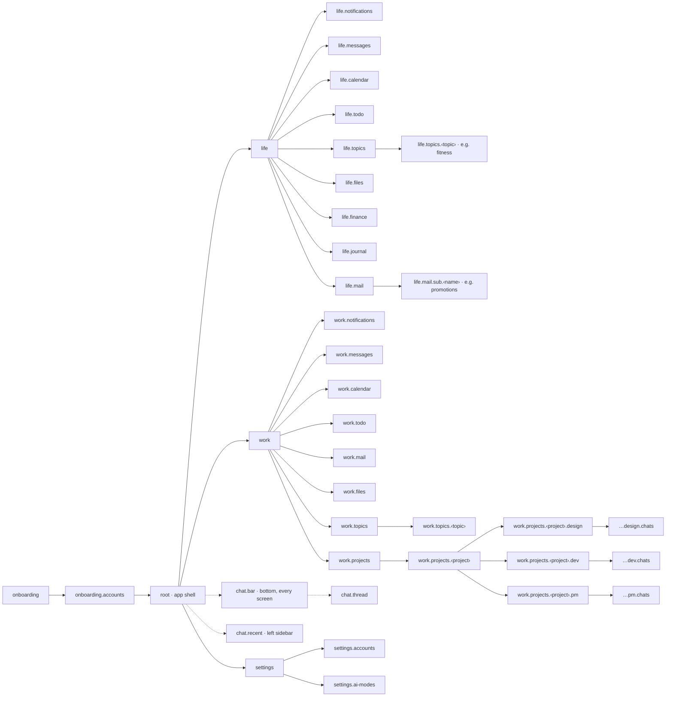

# IA map — screens and modules

> Status: evergreen — the information architecture of Personal Agent: every
> node with a stable id, its parent and its screen type. The source for task 1;
> specs, screens and the component registry refer to nodes by these ids.

<!--
TASK 0 STATE (2026-11-26): drafted from the owner's product brief
(FOUNDATIONS.md § Product brief); confirmed by the owner at G-0. After G-0 a
new node or a moved node is a big task (WORKFLOW.md § Big task or small task).
Conventions: ids are lower-case dotted paths; `<name>` marks a dynamic node
(one instance per topic, project or user-created sub-module); "global
element" nodes are present on every screen and are not pages. The node table
is the id source; the Mermaid tree shows the same ids (labels starting with
"…" abbreviate the parent path). `workflow`, `memory` and `sub` are reserved
segments: `<module>.workflow` and `<module>.memory` are the module's editor
and memory, `<module>.sub.<name>` a user-created sub-module.

-->

## Tree

Every module is backed by a **workflow** that runs on a schedule and rewrites
the module's screen, and by a **memory**. Both are reached from inside the
module (`<module>.workflow`, `<module>.memory`), not from the tree; the
workflow opens as a node-based editor (D-10).

**Every module shares one frame (D-12):** a run-state header (last run and
result, next run, running now, failure, items awaiting approval, history), a
body assembled from registered blocks by the workflow's output, and the
entries to workflow and memory. Layout changes only when the workflow is
edited; content changes per run, with what-changed markers.

`life.mail.sub.<name>` stands for a pattern, not one node: **any base module
in either layer** can grow user-created sub-modules out of conversations the
user marks persistent (or the AI converts). The diagram shows one example.

## Nodes

| IA id | Node | Parent | Screen type | Notes |
| --- | --- | --- | --- | --- |
| `onboarding` | Onboarding | — | first-run flow | Before the shell; presents the Life / Work split first, then connects accounts; the shell opens in Life afterwards (D-21). "Shown once" is proposed, `G-0` |
| `onboarding.accounts` | Connect accounts | `onboarding` | wizard step | The user connects the platforms the modules draw on (Google, Slack, Figma, GitHub …); same connectors as `settings.accounts`, which is where they are changed later |
| `root` | App shell | — | shell | Layer switch (Life / Work), chat bar, sidebar toggle; reached after onboarding |
| `life` | Life | `root` | layer home | Overview of the life modules |
| `life.notifications` | Notifications | `life` | module | A workflow that reads every other Life module's output and surfaces the most important items (D-13) |
| `life.messages` | Messages | `life` | module | Connected messaging accounts |
| `life.calendar` | Calendar | `life` | module | The one module whose data is shared with `work.calendar` (D-09) |
| `life.todo` | To-do | `life` | module | |
| `life.mail` | Mail | `life` | module | |
| `life.files` | Files | `life` | module | |
| `life.finance` | Finance records | `life` | module | |
| `life.journal` | Journal | `life` | module | |
| `<module>.sub.<name>` | User-created sub-module (e.g. `life.mail.sub.promotions`) | any base module, either layer | sub-module home | Born from a conversation the user switched to *persistent*, or converted by the AI; shows the workflow's standing output (e.g. the mail it pushed and why); its workflow and memory are edited like any module's; dynamic node (D-08) |
| `life.topics` | Topics | `life` | module index | Every conversation with the AI, filed automatically by theme |
| `life.topics.<topic>` | One topic (e.g. fitness) | `life.topics` | topic home | AI-written summary of the important information from the records, then every related conversation; dynamic node |
| `work` | Work | `root` | layer home | Overview of the work modules |
| `work.notifications` | Notifications | `work` | module | Same mechanism as `life.notifications`, over the Work modules (D-13) |
| `work.messages` | Messages | `work` | module | |
| `work.calendar` | Calendar | `work` | module | Shares data with `life.calendar`; the only Life ↔ Work bridge (D-09) |
| `work.todo` | To-do | `work` | module | |
| `work.mail` | Mail | `work` | module | |
| `work.files` | Files | `work` | module | |
| `work.projects` | Projects | `work` | module index | |
| `work.projects.<project>` | One project | `work.projects` | project home | Dynamic node; holds the sub-modules below |
| `work.projects.<project>.design` | Design | `work.projects.<project>` | sub-module | |
| `work.projects.<project>.design.chats` | Chats | `…design` | conversation list | Every conversation under this sub-module, with a summary — a filtered view of `work.topics` (see § Topics, sub-modules and chats) |
| `work.projects.<project>.dev` | Development | `work.projects.<project>` | sub-module | |
| `work.projects.<project>.dev.chats` | Chats | `…dev` | conversation list | Filtered view, as above |
| `work.projects.<project>.pm` | Project management | `work.projects.<project>` | sub-module | |
| `work.projects.<project>.pm.chats` | Chats | `…pm` | conversation list | Filtered view, as above |
| `work.topics` | Topics | `work` | module index | Same mechanism as `life.topics`, work-side |
| `work.topics.<topic>` | One topic | `work.topics` | topic home | Dynamic node |
| `chat.bar` | Chat bar | `root` | global element | Fixed to the bottom of every screen; from each input it either answers **in place** — a panel expanding above the bar, in the current screen's context, filed into Topics afterwards (D-23) — or opens a dedicated chat; carries the **one-off / persistent** switch for the current conversation (D-08) |
| `chat.thread` | Dedicated chat | `chat.bar` | chat window | Opened by the bar for a topic that needs its own thread; filed into Topics afterwards; can be switched to *persistent* at any time, which creates `<module>.sub.<name>` under the module it concerns |
| `chat.recent` | Recent conversations | `root` | global element | Left sidebar, expandable, listing the user's recent conversations in the **current layer only**; its contents switch with the layer (D-15). Collapsed by default: proposed, `G-0` |
| `settings` | Settings | `root` | settings home | |
| `settings.accounts` | Connected accounts | `settings` | settings page | Google, Slack, Figma, GitHub and other personal or corporate platforms |
| `settings.ai-modes` | AI behaviour modes | `settings` | settings page | Autonomous / assisted / deferred per kind of task |
| `<module>.workflow` | Module workflow editor | any module or sub-module | node canvas | Entered from the module; the workflow that runs on a schedule and rewrites the module's screen, shown as connected nodes (steps, conditions, schedule, outputs) the user can read and edit; also editable by talking to the AI (D-10) |
| `<module>.memory` | Module memory | any module or sub-module | panel | What the module remembers and which modules of the **same layer** it shares with; nothing crosses Life ↔ Work except calendar data (D-09) |

## Decided (D-07, 2026-11-26)

- `life.topics` / `work.topics` are the home of **all** conversations;
  `chat.recent` is a shortcut into them, not a second store.
- The five shared base modules (messages, calendar, to-do, mail, files) are
  **one component family** rendered in both layers; the task-1 spec decides
  the component inventory.
- An **onboarding** flow runs once before the shell; its job is connecting the
  user's platform accounts.

## Decided (D-08, 2026-11-26)

- Every conversation is **one-off by default and switchable to persistent**,
  in the chat bar or the dedicated chat, at any time. Persistent means the AI
  turns it into a sub-module with its own workflow under the module it
  concerns (`<module>.sub.<name>`); the AI may also propose the conversion.

## Decided (D-09, D-10, D-11, 2026-11-26)

- Only **calendar data** crosses between Life and Work; every other module,
  memory and workflow stays in its layer.
- **Every module is a scheduled workflow** that rewrites its own screen; its
  logic is shown and edited on a **node-based canvas**, never as skill text.
- The **prototype shows every core differentiator** (list in
  `FOUNDATIONS.md` § Product brief); the task-1 spec sizes it.

## Decided (D-12, D-13, 2026-11-26)

- A workflow rewrites its screen through a **page description that references
  registered blocks only**; layout changes only when the workflow is edited.
- Workflows start on **schedule, event, by hand, or from another module of
  the same layer**; triggers are nodes.
- Every module shares **one frame** with a run-state header.
- A **notifications module per layer** extracts the most important items from
  every module of that layer; there is **no cross-layer notifications view**
  (D-14).

- `chat.recent` lists the **current layer's** conversations only and switches
  with the layer (D-15).

## Prototype scope — pet-grooming shop manager (D-26, D-27; module list and flow scripts proposed, `G-0`)

The prototype builds the **Work layer only**, for one example user: the
manager of a small pet-grooming shop. The generic base modules (`work.mail`,
`work.todo`, `work.files`, `work.projects…`) and the whole Life layer stay in
the product IA above but are **not built**. The shop's modules are instances
of the module mechanism (D-10, D-12): each is a scheduled workflow with the
shared frame.

| IA id | Module (zh-CN label) | What its workflow does, in this shop |
| --- | --- | --- |
| `work.notifications` | 通知 | Surfaces the most important items from every module below (D-13) |
| `work.appointments` | 预约 | Grooming bookings by day and groomer; confirms tomorrow's appointments with customers, flags no-replies and freed slots |
| `work.clients` | 顾客与宠物 | Customer and pet records: breed, coat, last visit, notes, next due; reminds when a pet is due |
| `work.inventory` | 商品与库存 | Products sold and supplies used (shampoo, food, accessories): stock levels, sales, restock suggestions below a safety level |
| `work.shifts` | 排班 | Staff rota against the appointment load; proposes shifts, handles swap requests |
| `work.messages` | 消息 | Customer messages from connected channels, triaged into the modules above |
| `work.topics` | 话题 | Archive of every conversation with the AI, filed by theme, with summaries (D-07, D-20) |

Global elements and settings (`chat.bar`, `chat.thread`, `chat.recent`,
`settings.accounts`, `settings.ai-modes`, `onboarding`) are built as in the
product IA; for the prototype the shell opens in Work after onboarding.

**Hero flow — the AI learns her grooming times (D-27; script proposed, `G-0`).**
The owner's scenario: she takes about four hours for a long-haired large dog
and two for a short-haired small dog; she wants the AI to learn how long she
actually takes per breed and coat, and to change the appointment and shift
rules accordingly. The prototype shows the conversation becoming a workflow
**and** the workflow changing over the following weeks. Time is advanced with
a prototype-only control (§ Prototype devices).

| Stage | What happens | What the screen shows | Differentiator |
| --- | --- | --- | --- |
| 0 · 今天 — the conversation | In `work.appointments` she sees an Alaskan Malamute booked for the default two hours. In the chat bar: "我给长毛大狗做一次要 4 小时，短毛小狗 2 小时左右。以后帮我按狗的品种和毛长估时间，预约和排班都按这个来。" | The answer appears **in place**: the AI restates it as a small rule table (长毛大型 4 h · 短毛小型 2 h · 其他 3 h, to be learned) and says this sounds like a standing rule, offering to make it persistent | In-place answer (D-23); AI proposes the conversion (D-08) |
| 1 · 变成工作流 | She accepts. `work.appointments.sub.duration` ("服务时长") is created and opens on its node canvas | Trigger *预约新建或修改* and *每周一复盘* → source *顾客与宠物档案（品种、毛长、体型）* → step *估算时长*（规则表 + 已记录的实际耗时）→ action *设置预约时长*（**autonomous**）→ action *建议排班调整* to `work.shifts`（**assisted**）→ learning step *记录实际耗时* → condition *偏差超过 30 分钟* → action *提议修改规则*（**deferred**）. A **memory** node shows "各品种实际耗时：暂无记录" | Node editor read-and-adjust (D-10, D-16); modes per action (D-22); memory shared with `work.shifts` inside the layer (D-09) |
| 2 · 第 1–2 周 — learning | Time advances two weeks. Each finished appointment records its actual duration (the groomer taps *开始* / *完成* in the appointment) | The sub-module's screen is rewritten after each run: estimated vs actual per appointment, what-changed markers; the memory table fills (金毛 3 h 40 · 比熊 2 h 10 · 边牧 3 h 05 …) | Module = scheduled workflow rewriting its screen from blocks (D-12); memory as a visible, growing thing |
| 3 · 第 3 周 — the first change | Monday review runs: five Golden Retrievers averaged 3 h 40, under her 4 h | `work.notifications` holds a **deferred** item: "金毛平均 3 小时 40 分，比你设的 4 小时短，要改成 3.5 小时吗？" She accepts. The rule table changes; the canvas does not. `work.appointments` now books Goldens at 3.5 h; `work.shifts` shows the freed half hour and proposes opening a slot | Learning changes **memory**, not the workflow; cross-module effect; deferred mode for a rule change (D-22) |
| 4 · 第 2 个月 — the workflow itself changes | The review finds that first-time dogs take about 30 minutes longer regardless of breed | A **deferred** proposal to add a condition: *第一次来的狗 +30 分钟*. On the canvas the new node and its edges are highlighted as a diff; she approves (**assisted**) and the workflow becomes version 2, with the previous version in the module frame's history | The workflow evolves — "未来的变化"; versioned, explainable (why was this booked for 4 h?) |
| 5 · 回看 | She opens `work.topics` | The original conversation is filed under a topic the AI named "服务时长规则", with a summary of how the rule changed over two months and links to the sub-module | Topics as the archive (D-20) |

**Secondary flow — tomorrow's confirmations.** "明天有哪些预约？帮我给顾客发确认。"
→ in-place answer → switched to persistent → `work.appointments.sub.confirmations`
(trigger 19:00; *发确认* autonomous; *无回复则提醒我* deferred) → next evening the
screen is rewritten and two no-replies sit in `work.notifications`. It shows the
same mechanics in one evening and is the warm-up for the hero flow.

**Prototype devices (not product features).** A *时间推进* control in the shell
jumps between the hero flow's stages with faked data; the module frame's run
history and the canvas version history are real product features that the
device merely fills. Nothing else is simulated.

## Topics, sub-modules and chats (D-20)

- A **topic** (`*.topics.<topic>`) is a filing of conversations with an
  AI-written summary, not a module: it has no workflow, no memory and no
  module frame. Topics are the **archive** of every conversation (D-07).
- A **persistent conversation** becomes `<module>.sub.<name>`, a real module
  with workflow, memory and frame. Its conversations stay filed in Topics as
  well — the archive is never the live surface, so the double filing is
  intended; the topic home links to the sub-module.
- `…chats` under a project sub-module is a **filtered view** of
  `work.topics`, scoped to that sub-module; it stores nothing of its own.

## Open at G-0

The review's owner questions are decided (D-19…D-25). Still marked
"proposed" for the G-0 pass itself: `chat.recent` collapsed by default,
`onboarding` shown once, and the tooling items in `FOUNDATIONS.md` (Vite,
Style Dictionary, the verification matrix, axe-core + Lighthouse).
