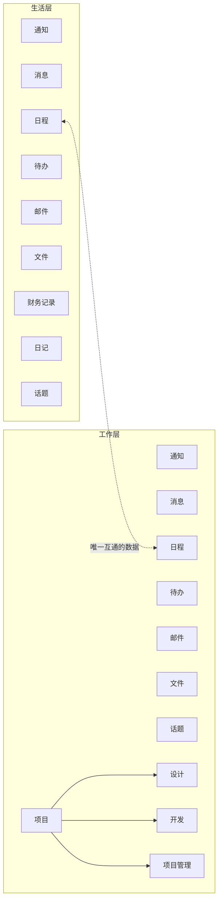
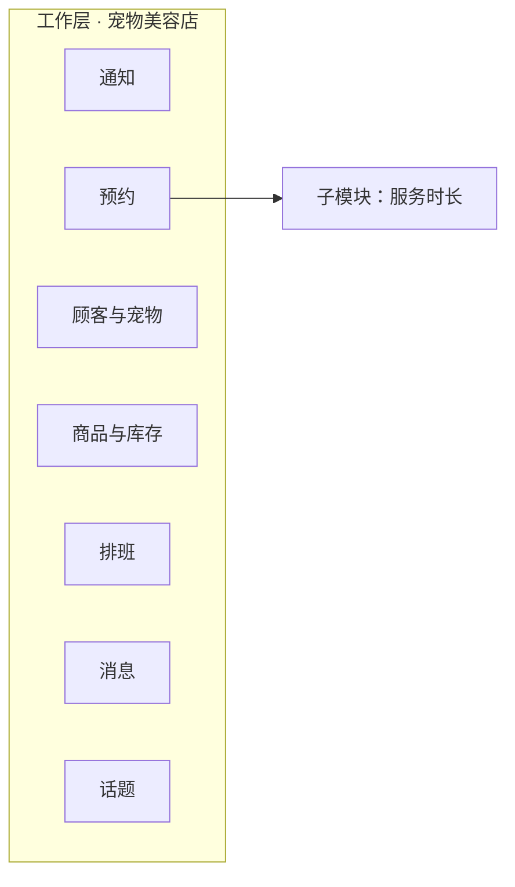

# Personal Agent — 产品构想

> Status: evergreen — 面向项目外读者的中文产品构想：Personal Agent 是什么、为什么这样做、
> 原型讲哪一个人的故事、还有什么没定。它从仓库里的设计文档整理而来，并随之更新。

## 一句话

Personal Agent 是一个给普通人用的个人 AI 工作台。它把你的生活和工作整理成两层相互连接的模块，每个模块连着你自己的账号，背后跑着一套按计划运行、可以像节点图一样打开来改的工作流，同一层的模块共享记忆，AI 在模块之内和模块之间主动工作。屏幕底部始终有一条聊天栏接收你的要求，只在需要时才打开专门的聊天窗口。你看到的是被安排妥当的事情，而不是一长串对话记录。

## 为什么不是又一个聊天框

今天大多数 AI 助手都围着一个聊天框打转：所有能力藏在输入框后面，AI 替你做过的事散落在一条条对话里，想找上次的结果要往上翻，想让它再做一次要再说一次。对话是**提出要求**的好方式，却是**保存结果**的坏方式——事情做完就散了，AI 也只能等你开口。

Personal Agent 把这个关系倒过来：界面是一组模块，AI 围着模块工作。邮件模块里放着值得你看的邮件，预约模块里放着排好的预约，排班模块里放着下周的班次。聊天栏还在，但它是入口，不是家。

## 两层系统

产品分成**生活层**和**工作层**。两层都有五个基础模块：消息、日程、待办、邮件、文件。生活层另有财务记录和日记；工作层另有项目，每个项目下再分设计、开发、项目管理。每一层还各有一个通知模块和一个话题模块。

分层是有意为之：同一层的模块互相共享记忆，AI 在工作里记住的事服务于工作，不会混进生活。两层之间**只有日程数据互通**——时间是一个人无法一分为二的东西。除此之外什么都不跨层：记忆不跨，工作流不跨，通知也不跨。账号本身可以同时挂在两层，比如同一个 Google 账号既喂生活层的邮件，也喂工作层的邮件；隔开的是由此衍生出的数据、记忆和工作流，不是账号连接。

## 模块即工作流

每个模块背后都有两样东西：一套**工作流**和一份**记忆**。工作流按计划运行，把每次运行的结果写回模块的界面。所谓"改写界面"，不是让 AI 随手生成一个页面，而是从一套注册过的区块里挑选、拼装：内容每次运行都会变，布局只在工作流本身被修改时才变；每次运行标出和上次相比哪里变了，你也可以把某个区块固定在原位。这样模块永远认得出来。

工作流不只按时间表启动。连接账号里发生的事件、你手动点一下、同一层另一个模块的产出，都可以触发它——触发条件本身就是工作流里的节点。

所有模块共用一个框架：顶部是运行状态（上次运行时间和结果、下次运行、正在运行、失败原因、等待你批准的事项、运行历史），中间是由区块拼成的正文，底部是进入这个模块的工作流和记忆的入口。

打开工作流，看到的是一张**节点图**：步骤、条件、时间表、输出，用连线连成一张普通人读得懂的画布，而不是一份只有程序员才看的"技能"文本。它的定位是**看懂并微调**——改一个时长、调一个阈值、把某个动作改成先问我——而不是从零搭建。不想自己动手，直接对 AI 说要改什么也行。

## 对话如何变成能力

**聊天栏**固定在每个屏幕的底部。你输入一句话，AI 会判断是就地回答——在聊天栏上方展开一个面板，结合当前屏幕的上下文作答——还是为这个话题打开一个专门的聊天窗口。没有一个独立的"主线程"页面。

每一次对话默认是**一次性**的，但随时可以切成**持续**的。切成持续，意味着 AI 把这次对话变成一个真正的子模块，带着自己的工作流和记忆，挂在它所涉及的模块下面。AI 也会在合适的时候主动建议把一次对话转成持续的。

所有对话都会按主题自动归档到**话题**里：话题的首页先是 AI 从这些记录里提炼出的重要信息摘要，往下是每一条相关对话。话题是全部对话的归档；左侧可展开的侧栏列出当前层的最近对话，作为进入话题的快捷方式，切层时随之切换。

每一层还有一个**通知**模块。它本身也是一套工作流，读取本层所有其他模块的产出，把最重要的事项放到一处。没有跨两层的总通知。

## AI 怎么被信任

一个会主动做事的 AI，最需要回答的问题是：它什么时候可以自己做，什么时候得先问我。Personal Agent 给 AI 三种**行为模式**：**自主**（autonomous，直接执行）、**协助**（assisted）、**待批准**（deferred，先放进等待批准的队列，你点头再做）。AI 为每一件具体的任务选择模式，依据三样东西：它对这件事有多大把握、做错了代价有多大、做了之后能不能撤回。

你可以按任务类型设定模式，而你设的模式是**上限**：AI 只能在这个上限之下选，不能越过。你没设的地方由 AI 自己判断，默认用协助模式。

## 第一个故事：宠物美容店店长

上面说的是产品。原型不会把它全部做出来，而是只讲**一个人的故事**：一家小宠物美容店的店长。她卖商品、接美容预约、给几名员工排班。原型只做工作层，模块就是她店里的事；生活层和通用的基础模块留在产品构想里，暂不做。第一次打开先走一遍初始设置，把她在用的平台账号接进来，然后直接进入工作层。

| 模块 | 它的工作流在这家店里做什么 |
| --- | --- |
| 通知 | 从下面每个模块里挑出最要紧的事 |
| 预约 | 按天和美容师排美容预约；向顾客确认明天的预约，标出没回复的和空出来的时段 |
| 顾客与宠物 | 每只狗一份档案：名字、主人、品种、毛长、体型、脾气备注、每次实际耗时、下次该来的时间；到期提醒 |
| 商品与库存 | 卖的商品和用的耗材：库存、销量，低于安全线提示补货 |
| 排班 | 对照预约量排员工班次，提出班次，处理换班 |
| 消息 | 接入渠道里的顾客消息，分流到上面各模块 |
| 话题 | 全部对话的归档，带摘要 |

主线故事是 **AI 学会她的服务时长**，分六个阶段：

1. **今天。** 预约模块里，一只阿拉斯加被按默认两小时排了进去。她在聊天栏里说："我给长毛大狗做一次要 4 小时，短毛小狗 2 小时左右。以后帮我按狗的品种和毛长估时间，预约和排班都按这个来。" AI 就地回答：把这句话整理成一张小规则表（长毛大型 4 小时、短毛小型 2 小时、其他 3 小时），补一句同一品种的狗差别很大、它会按每只狗的名字分别记录，并提出这听起来像一条长期规则，要不要变成持续的。
2. **变成工作流。** 她同意。预约模块下多出一个叫"服务时长"的子模块，打开是一张节点图：触发（预约新建或修改、每周一复盘）→ 读取顾客与宠物档案 → 估算时长（来过两次以上的狗用它自己的记录，否则用品种表）→ 设置预约时长（自主）→ 建议排班调整（协助）→ 记录实际耗时 → 偏差超过 30 分钟则提议修改规则（待批准）。旁边是**记忆**，两张都看得见的表：品种大致时长（用她的经验值填好），以及每只狗的实际耗时（暂无记录，写在每只狗的档案里）。她要做的只是读一遍，必要时改个数字。
3. **第一、二周。** 每做完一次美容，美容师点一下开始和完成，实际耗时就记进去。子模块的界面每次运行后重写：估算和实际并排，标出变化。两张表慢慢填满：金毛「豆豆」3 小时 20 分，金毛「大福」4 小时 10 分（不配合，备注进了档案），比熊「雪球」2 小时 10 分……品种表随之重算，金毛约 3 小时 45 分；还停在经验值上的行标着"尚无数据"。
4. **第三周。** 周一复盘发现豆豆三次都在 3 小时 20 分左右，大福三次都在 4 小时 10 分左右，金毛 4 小时的经验值两头都不准。通知模块里出现一条待批准事项：金毛的大致时长改为 3 小时 45 分？来过两次以上的狗按自己的记录排——豆豆 3 小时 20 分，大福 4 小时 15 分？她点了同意。改的是记忆，节点图一个节点都没动。预约模块开始按豆豆和大福各自的记录排，新来的金毛按品种行；排班模块算出省下的时间，提议多开一个时段。
5. **第二个月。** 复盘又发现一件任何一只狗的记录都预测不了的事：狗第一次来，不论品种，都比后来多花半小时左右。这只能是一条规则。于是来了一条待批准的建议：在节点图上新增一个条件"第一次来的狗 +30 分钟"，新节点和连线高亮成一处改动。她批准，工作流成了第二版，上一版留在历史里。日后问"这只狗为什么排了四小时"，答案可以追溯。
6. **回看。** 她打开话题模块，当初那句话被归在一个 AI 命名的"服务时长规则"话题下，前面是这两个月规则如何变化的摘要，后面是每一条对话，并链接到那个子模块。

还有一条短的热身故事："明天有哪些预约？帮我给顾客发确认。"——就地回答，切成持续，变成预约模块下的一个确认子模块：每晚七点自动发确认（自主），没回复的提醒她（待批准）。第二天晚上界面重写，两条没回复的躺在通知里。同样的机制，一个晚上讲完。

原型里的后台数据是假的，时间靠一个只属于原型的"时间推进"控件在各阶段之间跳转；运行历史和工作流版本历史则是真正的产品功能。

## 还未决定的

- **还没有后端。** 原型阶段的数据是假的；真实数据如何接入、存在哪里，尚未设计。
- **商业模式和市场竞争** 没有讨论，也明确不在范围内。这是一次设计练习，不是商业计划。
- **先接哪些账号** 没有定。Google、Slack、Figma、GitHub 只是举例，第一批支持的平台待定。
- **生活层和通用基础模块** 属于产品构想，但什么时候做、以谁的故事做，还没有安排。
- **语言怎么切换**、初始设置是否只出现一次，这些细节留给原型的设计阶段决定。

---

<small>本文整理自项目仓库中的设计文档（产品基础、信息架构图、决策记录），只写其中已经写明的内容，没有写明的不做推测。</small>
