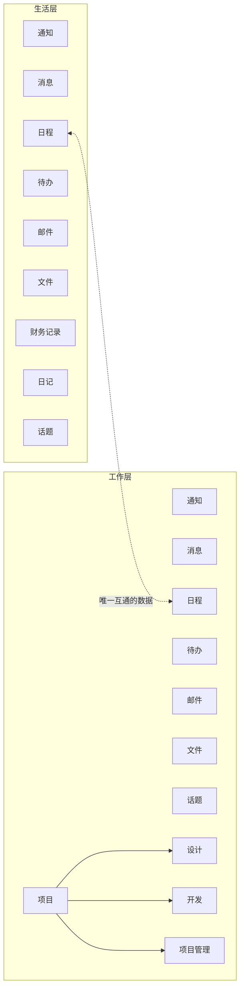

# Personal Agent — 产品构想

> Status: evergreen — 面向项目外读者的中文产品构想：Personal Agent 是什么、为什么这样做、
> 第一步做什么、还有什么没定。它从仓库里的设计文档整理而来，并随之更新。

## 一句话

Personal Agent 是一个给普通人用的个人 AI 工作台。它把你的生活和工作整理成两层相互连接的模块——消息、日程、待办、邮件、文件、财务记录、日记，以及工作中的项目——每个模块连着你自己的账号，背后跑着一套按计划运行、可以像节点图一样打开来改的工作流，同一层的模块共享记忆，AI 在模块之内和模块之间主动工作。屏幕底部始终有一条聊天栏接收你的要求，只在需要时才打开专门的聊天窗口。你看到的是被安排妥当的事情，而不是一长串对话记录。

## 为什么不是又一个聊天框

今天大多数 AI 助手都围着一个聊天框打转：所有能力藏在输入框后面，AI 替你做过的事散落在一条条对话里，想找上次的结果要往上翻，想让它再做一次要再说一次。对话是**提出要求**的好方式，却是**保存结果**的坏方式——事情做完就散了，AI 也只能等你开口。

Personal Agent 把这个关系倒过来：界面是一组模块，AI 围着模块工作。邮件模块里放着值得你看的邮件，待办模块里放着到期的事，项目模块里放着项目的进展。聊天栏还在，但它是入口，不是家。

## 两层系统

系统分成**生活层**和**工作层**。两层都有五个基础模块：消息、日程、待办、邮件、文件。生活层另有财务记录和日记；工作层另有项目，每个项目下再分设计、开发、项目管理三个子模块。每一层还各有一个通知模块和一个话题模块，下文再说。

分层是有意为之：同一层的模块互相共享记忆，AI 在工作邮件里记住的事服务于你的项目，不会混进生活；生活里的健身、账单、日记也不会出现在工作层。两层之间**只有日程数据互通**——时间是一个人无法一分为二的东西。除此之外什么都不跨层：记忆不跨，工作流不跨，通知也不跨。账号本身倒可以同时挂在两层，比如同一个 Google 账号既喂生活层的邮件，也喂工作层的邮件；隔开的是由此衍生出的数据、记忆和工作流，不是账号连接。

## 模块即工作流

每个模块背后都有两样东西：一套**工作流**和一份**记忆**。工作流按计划运行，把每次运行的结果写回模块的界面。所谓"改写界面"，不是让 AI 随手生成一个页面，而是从一套注册过的区块里挑选、拼装：内容每次运行都会变，布局只在工作流本身被修改时才变；每次运行标出和上次相比哪里变了，你也可以把某个区块固定在原位。这样模块永远认得出来，不会每天换一张脸。

工作流不只按时间表启动。连接账号里发生的事件、你手动点一下、同一层另一个模块的产出，都可以触发它——这些触发条件本身就是工作流里的节点。

所有模块共用一个框架：顶部是运行状态（上次运行时间和结果、下次运行、正在运行、失败原因、等待你批准的事项、运行历史），中间是由区块拼成的正文，底部是进入这个模块的工作流和记忆的入口。

打开工作流，看到的是一张**节点图**：步骤、条件、时间表、输出，用连线连成一张普通人读得懂、也改得动的画布，而不是一份只有程序员才看的"技能"文本。不想自己动手，直接对 AI 说要改什么也行。

## 对话如何变成能力

**聊天栏**固定在每个屏幕的底部。你输入一句话，AI 会判断是就地回答——在聊天栏上方展开一个面板，结合当前屏幕的上下文作答——还是为这个话题打开一个专门的聊天窗口。没有一个独立的"主线程"页面。

每一次对话默认是**一次性**的，但随时可以切成**持续**的。切成持续，意味着 AI 把这次对话变成一个真正的子模块，带着自己的工作流，挂在它所涉及的模块下面。比如"把我所有的促销邮件过一遍，按我的偏好把重要的推给我"，可以只做这一次，也可以变成邮件模块下的一个子模块，持续运行。AI 也会在合适的时候主动建议把一次对话转成持续的。

所有对话都会按主题自动归档到**话题**里：问过健身，就会出现一个健身话题；话题的首页先是 AI 从这些记录里提炼出的重要信息摘要，往下是每一条相关对话。话题是全部对话的归档；左侧可展开的侧栏列出当前层的最近对话，作为进入话题的快捷方式，切层时随之切换。在工作层，每个项目的设计、开发、项目管理子模块也各有一个汇总自己全部对话的视图。

每一层还有一个**通知**模块。它本身也是一套工作流，读取本层所有其他模块的产出，把最重要的事项放到一处。没有跨两层的总通知——日程仍是两层之间唯一的桥。

## AI 怎么被信任

一个会主动做事的 AI，最需要回答的问题是：它什么时候可以自己做，什么时候得先问我。Personal Agent 给 AI 三种**行为模式**：**自主**（autonomous，直接执行）、**协助**（assisted）、**待批准**（deferred，先放进等待批准的队列，你点头再做）。AI 为每一件具体的任务选择模式，依据三样东西：它对这件事有多大把握、做错了代价有多大、做了之后能不能撤回。

你可以按任务类型设定模式，而你设的模式是**上限**：AI 只能在这个上限之下选，不能越过。你没设的地方由 AI 自己判断，默认用协助模式。

## 第一步

第一次打开，先走一遍**初始设置**。它的第一步是介绍生活层和工作层的分法；接着把你已经在用的平台账号接进来——Google、Slack、Figma、GitHub 这类个人和公司的平台——每个账号挂到一层或两层。设置完成后进入生活层。

现阶段的目标是一个在浏览器里运行的**网页原型**，暂不做手机或桌面应用。原型不走窄切片，而是要把每一个核心差异点都做出来：两层系统和作为唯一桥梁的日程；一个按计划运行并改写自己界面的模块；节点式工作流编辑器；自动归档并带 AI 摘要的话题；一次对话从一次性切成持续并变成子模块；三种行为模式；底部聊天栏和专门的聊天窗口；初始设置流程；带运行状态的统一模块框架；汇总本层所有模块的通知模块。界面提供中文和英文，支持亮色和暗色两种模式。

## 还未决定的

- **还没有后端。** 原型阶段的数据可以是假的；真实数据如何接入、存在哪里，尚未设计。
- **商业模式** 还没有讨论过。
- **先接哪些账号** 没有定。Google、Slack、Figma、GitHub 只是举例，第一批支持的平台和顺序待定。
- **语言怎么切换**、设置流程是否只出现一次，这些细节留给原型的设计阶段决定。

---

<small>本文整理自项目仓库中的设计文档（产品基础、信息架构图、决策记录），只写其中已经写明的内容，没有写明的不做推测。</small>
